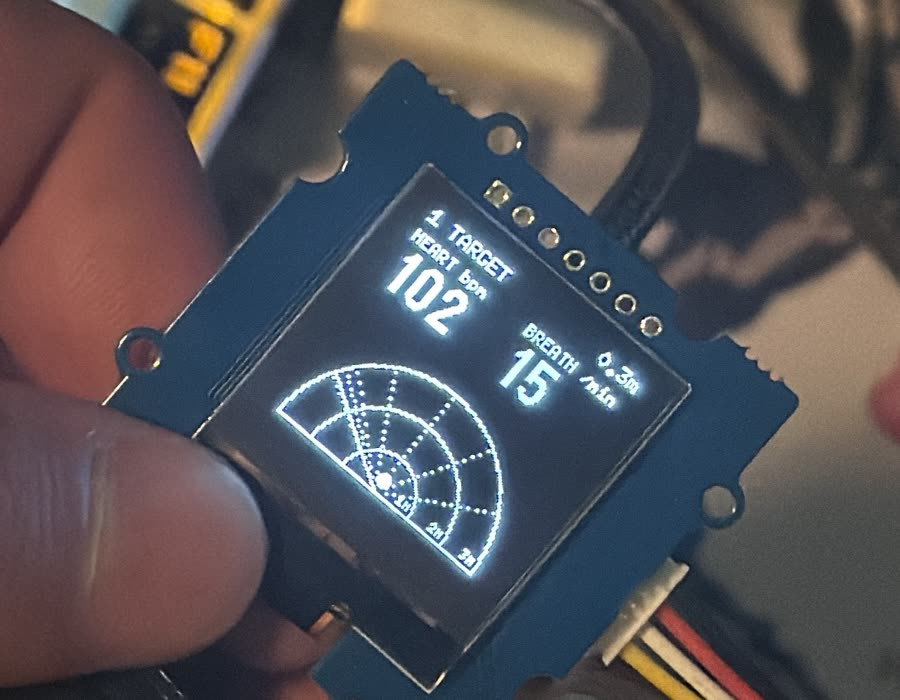
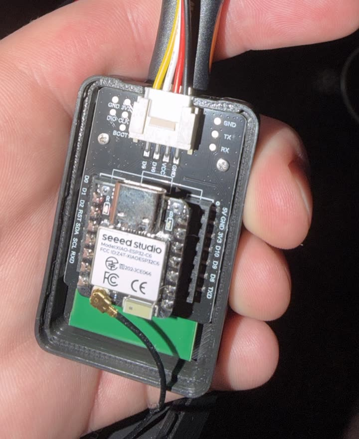

# Pocket Radar

A radar screen you can hold. A 60 GHz mmWave sensor tracks people in the room, and a 128x128 OLED draws them as live dots on a sweeping radar display. Sit still within 1.5 m and it shows your heart and breathing rate too.



## What it does

- Sweeping radar beam with a short trail, plus range rings at 2, 4 and 6 m
- Each person the radar tracks (up to 3) shows up as a dot, and pings when the beam passes over it
- Header shows the target count and the distance to the closest person
- Heart and breathing rate appear after you've held still for 3 s within 1.5 m, and show "hold still..." otherwise
- Runs at about 16 fps, with target updates about 8 times a second
- Logs everything to Serial once a second: radar firmware version, vitals, and each target's x/y in meters

## Hardware

| Part | Notes |
|---|---|
| [Seeed MR60BHA2 60 GHz mmWave kit](https://wiki.seeedstudio.com/getting_started_with_mr60bha2_mmwave_kit) | Radar module with a XIAO ESP32-C6 on the back |
| Grove OLED 1.12" SH1107 V3.0 (128x128) | Plugs into the kit's Grove port (D0 = SCL, D10 = SDA) |
| USB-C cable that carries data | Plenty of USB-C cables only carry power |



## Setup

1. Install **Arduino IDE 2**, then add the ESP32 boards URL in Preferences:
   `https://raw.githubusercontent.com/espressif/arduino-esp32/gh-pages/package_esp32_index.json`
2. In Boards Manager, install **esp32 by Espressif Systems** (3.x). Then select the **XIAO_ESP32C6** board and make sure **USB CDC On Boot** is Enabled.
3. Libraries:
   - **U8g2** from the Library Manager
   - **Seeed Arduino mmWave**, which isn't in the Library Manager. Download [Seeed-Projects/Seeed-mmWave-library](https://github.com/Seeed-Projects/Seeed-mmWave-library) and add it as a .zip library, or copy it into your `Arduino/libraries` folder.
4. Open `pocket_radar/pocket_radar.ino`, pick the board's COM port, and upload.

Uploading replaces the ESPHome firmware the kit ships with.

## Gotchas I hit

- **The kit has two USB-C ports.** The one you can reach through the case only supplies power, so the LED lights up but no COM port appears. To upload, use the XIAO's own port inside the case.
- **Check which screen you actually have.** The 1.12" Grove OLED is an SH1107 at 128x128, not the 0.96" SSD1315. With the wrong driver the screen just stays blank.
- **Use hardware I2C.** Software I2C ran this screen at 1 fps. The ESP32's hardware I2C on the same pins at 400 kHz runs it at 16 fps:
  ```cpp
  U8G2_SH1107_SEEED_128X128_F_HW_I2C u8g2(U8G2_R0, U8X8_PIN_NONE, D0, D10);
  u8g2.setBusClock(400000);  // before u8g2.begin()
  ```
- **`mmWave.update(timeout)` busy-waits for the full timeout.** The examples pass 100 ms, which caps your loop at 10 fps. This sketch uses 5 ms.
- **Placement matters more than code.** Aim the radar face (the side with the curved cutouts) at open floor, at about chest height. Keep chairs, fans and curtains out of the first meter. The radar is designed to hang on to people who sit still, so a chair swaying after you get up can turn into a sticky ghost target.

## Tuning

These are at the top of `pocket_radar.ino`:

| Setting | Default | What it does |
|---|---|---|
| `FLIP_X` | `0` | Set it to `1` if the dots move the opposite way you do |
| `MAX_RANGE_M` | `6.0` | Distance at the outer ring. The rings and labels scale with it |
| `VITALS_RANGE_M` | `1.5` | Heart and breathing only show within this distance |
| `STILL_MS` | `3000` | How long you have to hold still before vitals show |

## Tools

- `tools/oled_test`: a quick screen check with an fps counter. Run it first to make sure the display is wired right.
- `tools/radar_debug`: prints the radar's raw targets, distance, and heart and breathing rate to Serial, with no display.

## Limits

- Heart and breathing are experimental. Seeed says those modes are meant for sleep monitoring, within 1.5 m of a still person. Treat the readings as a fun readout, not a medical one.
- Seeed rates presence detection out to 6 m. In my testing, position tracking held a still person at 1.6 m and briefly picked someone up at 2.8 m. I still need to do a proper walk test past 3 m.
- The OLED is single-color, white.

## Next

- Run it off a battery so it actually fits in a pocket
- Switch to a color OLED for a green radar with a fading trail
- Smooth out the heart rate, and add a heart icon that pulses at your measured rate

## License

MIT
