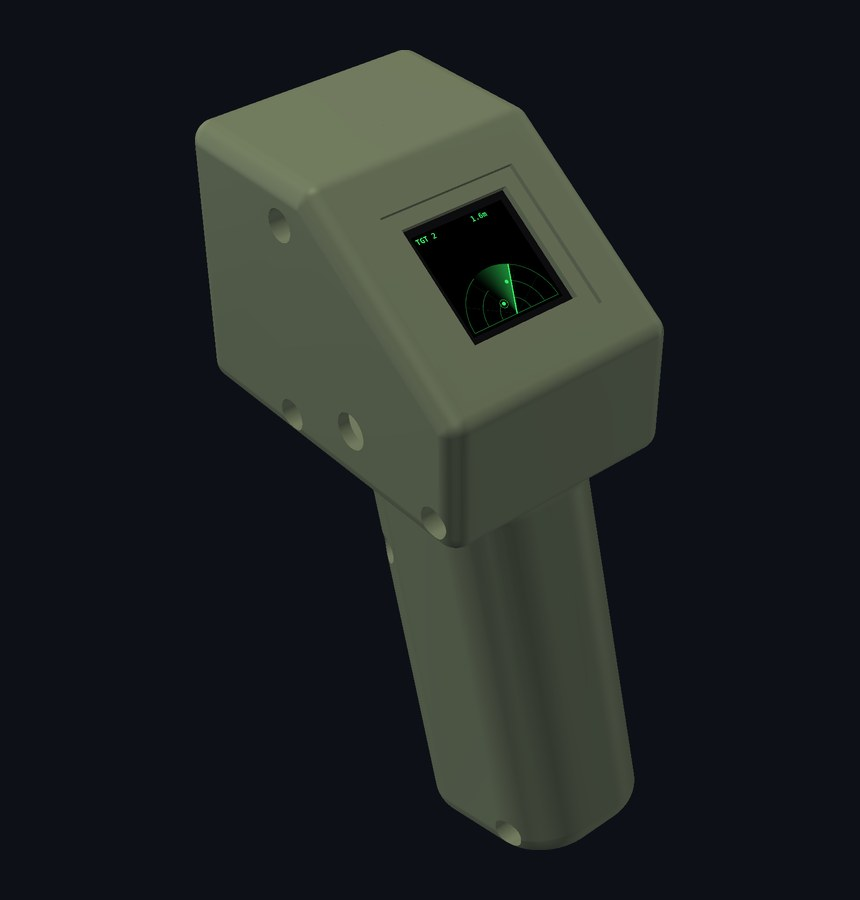
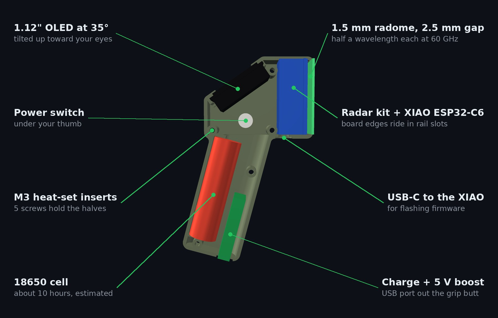

# Handheld enclosure (v0.1)

**Status: designed, not printed yet.** A few board dimensions are still estimates from datasheets. They're marked `MEASURE` in the script and I'll check them with calipers before the first print. Treat this as a work in progress, not a tested print.



## Layout

It's shaped like a radar gun, so you hold it out in front of you like the one in the game.

- The radar faces straight out the front, through a separate 1.5 mm radome plate.
- The 1.12" OLED sits on top, tilted 35° up toward your eyes. A recess over it takes a 1 mm green acrylic filter, since the OLED only lights up white.
- A raked pistol grip holds an 18650 cell and a charge + 5 V boost board, with its USB port out the bottom.
- There's a USB-C cutout under the radar for the XIAO's data port, so you can still flash firmware.
- Two shell halves close around everything and screw together: 5x M3x10 into M3 heat-set inserts.
- Overall it's about 50 x 73 x 133 mm.



## The radar window

60 GHz has a 5 mm wavelength in air, so a few millimeters of plastic matter. TI's [mmWave Radar Radome Design Guide (SWRA705)](https://www.ti.com/lit/swra705) gives two rules:

1. **Thickness:** make the plastic a whole number of half wavelengths thick, measured *inside the material*. That way the reflections off its front and back cancel. PLA/PETG has a dielectric constant of about 2.7 to 3, so the wavelength inside it is about 3 mm, and half of that is **1.5 mm**.
2. **Distance:** keep the plastic a whole number of half wavelengths from the antenna. Half a wavelength in air is **2.5 mm**.

The radome is its own part on purpose. Swapping plates lets me compare no window, 1.5 mm and 3 mm back to back without reprinting the shell.

## Files

| File | What it is |
|---|---|
| `pocket_radar_case.py` | Parametric CadQuery model. Every dimension is a variable at the top. |
| `pocket_radar_case_v0_1.step` | Assembly: both shell halves, the radome, plus simple stand-ins for the boards and battery. Opens in Fusion 360, Onshape, SolidWorks, etc. |

To regenerate the STEP and the print-ready STLs:

```bash
pip install cadquery
python pocket_radar_case.py      # writes to enclosure/out/
```

The script first runs a **fit check**: it intersects stand-ins for the radar kit, OLED, battery, boost board and switch with both shell halves, and reports any overlap or anything poking out of the case.

## Printing (once the measurements are confirmed)

- Lay each half on its outer side face, inside facing up. The exported STLs are already oriented this way.
- All internal features (rails, screen cradle, screw bosses, battery saddles) build up from that face, so nothing inside needs supports.
- The grip's side sits 9 mm above the head's side, so use "supports from build plate only" under the grip.
- Print the radome flat with 100% solid fill. PLA or PETG both work for it.

## Still to confirm

- `KIT_D`: depth from the radar face to the back of the XIAO's USB-C
- `KIT_PCB_OFF`: radar module face to the carrier board's front
- `KIT_EDGE_KEEPOUT`: a clear strip along the board's left/right edges for the rails to grip
- Where the XIAO's USB-C sits on the kit (assumed centered on the bottom edge)
- The OLED panel's thickness and where its active area sits on the board
- The battery and boost board choice
